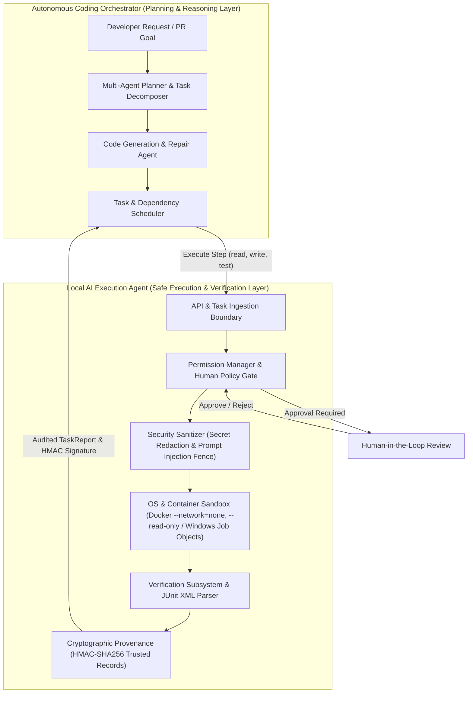

<div align="center">

# ⚡ Local-First, Model-Agnostic AI Execution Agent

### *Stop trusting what AI chatbots say. Start verifying what AI agents actually do.*

An open-source, evidence-driven autonomous coding framework that delegates real software engineering tasks to LLMs—with **OS/container containment**, **cryptographic execution provenance**, and **verifiable machine proof**.

[](https://www.python.org/)
[](https://fastapi.tiangolo.com/)
[](https://vitejs.dev/)
[](https://sqlite.org/)
[](https://github.com/MokuLakshithReddy/local-ai-execution-agent/actions/workflows/ci.yml)
[](EVIDENCE.md)
[](EVIDENCE.md)
[](LICENSE)

</div>

---

## 💡 The Big Idea in 30 Seconds

Most AI coding assistants (Copilot, Cursor, chat interfaces) are **"chatbots with text editors."** 
When an AI finishes writing code, it declares: 
> *"I have fixed the issue, refactored the module, and everything is working perfectly!"*

**In reality, you don't know if the code compiles, if tests actually ran, or if the agent hallucinated.** 

This project flips the paradigm from **subjective belief** to **objective proof**:
1. **Never Trust Claims**: The LLM's opinion is treated as an unverified hypothesis.
2. **Require Machine Evidence**: A task is **only** marked `COMPLETED` when independent test runners (e.g., `pytest`, `npm test`) exit with code `0`, git diffs confirm the modifications, and JUnit XML records are cryptographically verified.
3. **Execute Safely in Containment**: All commands execute inside **isolated Docker containers** (or native Windows Job Objects) with kernel-level network blocks (`--network=none`), read-only root filesystems, memory caps, and process limits.
4. **Local-First & Model-Agnostic**: Supports 100% offline local models via **Ollama** (complete on-device privacy). When configured with cloud LLM providers (**Gemini, Claude, GPT-4o**), prompts and workspace code snippets are transmitted to the respective provider's API according to their privacy terms.

---

## 🤔 Why This Matters: The Chatbot vs. Evidence Agent

| Capability | Standard AI Assistant / Chatbot | This AI Execution Agent |
|---|---|---|
| **Completion Criteria** | Subjective: LLM says *"Done!"* in chat. | **Objective**: Test runners exit `0`, assertions pass, and git diffs match. |
| **Output Integrity** | Can print fake test logs and claim they passed. | **Cryptographic Provenance**: JUnit XML signed with HMAC-SHA256 (deterministic canonical JSON). |
| **Process Execution** | Runs arbitrary commands directly on host terminal. | **Hard Containment**: Docker container sandbox (`--network=none`, `--read-only`). |
| **Escapes & Traversal** | Vulnerable to `cd ..`, path traversal, or env leaks. | **Strict Path Jail**: Canonical path sandboxing + strict env scrubbing. |
| **Runaway Loops** | Loops infinitely if it gets confused. | **Loop-Guards**: Repetitive action detection and hard step/timeout budgets. |
| **Model Lock-In** | Bound to one proprietary API. | **Model-Agnostic**: Ollama (Qwen, Llama), Claude, Gemini, OpenAI. |
| **Privacy & Storage** | Cloud-synced telemetry and histories. | **Local-First**: Embedded SQLite, local tokens, OS DPAPI / POSIX vault. |

---

## 🎬 How It Works: The Verifiable Lifecycle

When you ask the agent: *"Fix the authentication token expiry bug and verify with unit tests"*:

```
   ┌──────────────────────────────────────────────────────────────┐
   │ 1. INGEST & PLAN                                             │
   │ The agent explores workspace files (safe read_file, search). │
   │ Proposes step-by-step action plan and identifies criteria.   │
   └──────────────────────────────┬───────────────────────────────┘
                                  ▼
   ┌──────────────────────────────────────────────────────────────┐
   │ 2. AUTHORIZATION & HUMAN-IN-THE-LOOP                         │
   │ Routine file edits proceed; sensitive operations trigger     │
   │ human approval modals in the Glassmorphic Web Dashboard.     │
   └──────────────────────────────┬───────────────────────────────┘
                                  ▼
   ┌──────────────────────────────────────────────────────────────┐
   │ 3. SANDBOXED EXECUTION (DOCKER / JOB OBJECTS)                │
   │ Modifies files via patch_file. Executes test runner inside   │
   │ container (--network=none, memory caps, non-root user).      │
   └──────────────────────────────┬───────────────────────────────┘
                                  ▼
   ┌──────────────────────────────────────────────────────────────┐
   │ 4. OBJECTIVE MACHINE EVIDENCE GATHERING                      │
   │ Parses structured JUnit XML directly from test process.      │
   │ Partitions outcomes: passed, failed, and skipped tests.      │
   └──────────────────────────────┬───────────────────────────────┘
                                  ▼
   ┌──────────────────────────────────────────────────────────────┐
   │ 5. CRYPTOGRAPHIC PROVENANCE & REPORT                         │
   │ Issues a tamper-evident TrustedExecutionRecord (HMAC-SHA256).│
   │ Generates audited TaskReport with diffs and exit codes.      │
   └──────────────────────────────────────────────────────────────┘
```

---

## 📊 The Truth Table: Evidence-Grounded Verification

> **What Verification Proves (and What it Does Not):**
> Verification proves that designated automated test suites and linters executed inside the containment sandbox, exited with return code `0`, and that git diffs reflect the modified files. It confirms demonstrable test-runner evidence; it does **not** constitute mathematical proof of complete functional correctness or the absence of all software bugs.

The verification engine (`agent/verification/verifier.py`) enforces an immutable outcome matrix:

| Code Modified? | Verification Tests Executed? | Exit Code | Resulting Task Status | What Actually Happened |
|:---:|:---:|:---:|:---:|---|
| **Yes** | **Yes** | `0` (Success) | **`COMPLETED`** | ✅ **Verified Completion**: Tests ran inside sandbox, passed, and diff matches. |
| **Yes** | **Yes** | `!= 0` (Fail) | **`PARTIALLY_COMPLETED`** | ❌ **Failed Verification**: Tests failed. Agent is forbidden from claiming victory. |
| **Yes** | **No** | N/A | **`PARTIALLY_COMPLETED`** | ⚠️ **Unverified Modification**: Files were edited, but no automated test proved it. |
| **No** | N/A | N/A | **`COMPLETED`** | ℹ️ **Informational Task**: Read-only exploration (e.g., architecture audit). |
| Any | Timeout / Block | Error | **`FAILED` / `BLOCKED`** | 🛑 **Execution Failure**: Sandbox violation or resource budget exhausted. |

---

## 🏛️ Architectural Separation: Safe Execution Agent vs. Autonomous Coding Orchestrator

This project is intentionally designed with a strict architectural boundary separating **Execution Safety & Verification** from **High-Level Planning & Multi-Agent Orchestration**:



### Division of Responsibilities

| Dimension | Autonomous Coding Orchestrator | Local AI Execution Agent (This Project) |
|---|---|---|
| **Core Question Answered** | *"What should we build, which files should we change, and how do we recover from complex bugs?"* | *"Can this action run safely on this machine, and did the tests demonstrably pass?"* |
| **Primary Scope** | Multi-agent workflows, code planning, iterative repair loops, repository indexing, conversation trees. | Operating system containment, process supervision, filesystem boundaries, test verification, cryptographic provenance. |
| **Execution Boundary** | Never touches physical OS files or terminal subprocesses directly; delegates all actions. | Enforces Docker container containment (`--network=none`, `--read-only`, memory caps) or Windows Job Objects. |
| **Trust Model** | Reasoning layer: generates hypotheses and proposed patches. | Verification trust layer: evaluates claims against automated test runners (`exit_code == 0`, JUnit XML). |
| **Security Guarantees** | Prompts and high-level goal constraints. | Canonical path traversal blocks, secret scrubbing across DB & logs, tamper-evident HMAC signing. |

### How the Two Systems Compose

In production multi-agent systems, the **Autonomous Coding Orchestrator** acts as the architect and coordinator. When it decides to explore files, apply an edit, or run unit tests, it **never** runs raw terminal commands or opens files directly. Instead, it dispatches isolated tool calls to the **Local AI Execution Agent** via structured REST/WebSocket APIs.

The Execution Agent validates permissions against user policy, checks for path traversal escapes, redacts sensitive secrets, executes within container/kernel isolation, parses the structured output, and returns an HMAC-signed `TrustedExecutionRecord`. The Orchestrator inspects this objective proof to determine its next planning step.

---

## 🚀 Quick Start (Up & Running in 2 Minutes)

### Prerequisites
- **Python 3.10+**
- **Node.js 18+** & `npm`
- **Docker** (optional, recommended for full container isolation)

### 1. Clone & Set Up Virtual Environment

```bash
# Clone the repository
git clone https://github.com/MokuLakshithReddy/local-ai-execution-agent.git
cd local-ai-execution-agent

# Set up Python virtual environment
# Windows:
python -m venv venv
.\venv\Scripts\activate

# Linux / macOS:
python3 -m venv venv
source venv/bin/activate

# Install dependencies
pip install -r requirements.txt
```

### 2. Verify Your Environment (57 Passing Tests)

Run the automated test suite to verify kernel job limits, sandbox boundaries, and provenance hashing:

```bash
pytest tests/ -v
```

### 3. Launch the Agent & Web Dashboard

```bash
python main.py
```

Open your browser to:
👉 **[http://localhost:8000](http://localhost:8000)**

### 4. (Optional) Start the React UI in Dev Mode

```bash
cd ui
npm install
npm run dev
```

---

## 🛡️ Hardened Defenses & Security Invariants

In response to extensive adversarial testing, the runtime implements 5 layers of defense:

### 1. Container Sandbox & Terminal Containment
- **Security Boundary Notice**: File and network containment rely on Docker container isolation (or host OS Job Objects). Command-line string filtering in `validate_sandbox_command()` is an early syntactic lint, not an OS-enforced boundary.
- **Container-First by Default**: `RunCommandTool` defaults to `sandbox_mode="container"`. Host execution is rejected when containment is required.
- **Kernel-Level Isolation**: Spawns commands via `asyncio.create_subprocess_exec("docker", "run", ...)` with:
  - `--network=none`: Blocks outbound network connections at the kernel level (raw sockets and scripts cannot leak data).
  - `--read-only`: Prevents modification of root system files.
  - `-v {workspace}:/workspace:rw`: Only the target workspace folder is accessible.
  - `--memory=512m`, `--pids-limit=32`, `--cap-drop=ALL`.
- **Windows Kernel Job Objects**: On Windows host fallback, processes are bound to native Job Objects via `ctypes.windll.kernel32`:
  - `JOB_OBJECT_LIMIT_KILL_ON_JOB_CLOSE`: Instant child process termination on exit or timeout.
  - Hard caps on active processes (16) and memory (512 MB).
- **Timeout Cleanup & Daemon Pruning**: Deterministically named containers (`agent-sandbox-<uuid>`) are forcibly stopped (`docker rm -f`) and verified removed if a command times out.

### 2. Cryptographic Provenance & Deterministic Canonical JSON
- **Zero Fabrication**: Prevents agents or malicious scripts from outputting fake `1 passed in 0.05s` strings to trick verification.
- **Deterministic Canonical JSON Serialization**: All test results (`run_id`, `runner`, `command`, `exit_code`, `total`, `passed`, `failed`, `skipped`, `ephemeral`, `nodes`, `timestamp`) are serialized into canonical JSON (alphabetically sorted keys, compact separators `','` and `':'`) and signed using HMAC-SHA256, eliminating delimiter ambiguity and formatting collision risks.
- **Skipped-Test Isolation**: Skipped tests are recorded separately (`skipped_nodes`) and **never** counted as passed. Reports with zero passing tests or count inconsistencies are rejected immediately.
- **Persistent Key Lifecycle & Fail-Closed Protection**: Signing keys are stored at `~/.config/ai_execution_agent/verification.key` with atomic creation (`O_CREAT | O_EXCL`), restrictive permissions (`0600` on POSIX, user ACL lockdown via `icacls` on Windows), or configured via `AGENT_VERIFICATION_SECRET`. If storage is unwritable, it fails closed (ephemeral keys are strictly opt-in).
- **Key Rotation**: Provides `rotate_verification_secret()`, atomically establishing new keys and revoking historical signatures.

### 3. Path Traversal & Symlink Defense
- Every filesystem operation passes through `resolve_safe_path()`, resolving canonical real paths and verifying `os.path.commonpath([resolved, workspace]) == workspace`.
- Prevents symlink attacks, directory traversal (`../../etc/passwd`), and out-of-boundary access.

### 4. Credential Vault & In-Memory Sanitization
- **OS-Native Key Storage**: Windows DPAPI (`CryptProtectData`) on Windows; Fernet key with atomic permissions on POSIX.
- **Automatic Redaction**: Scrubbing engine masks API keys (`sk-*`, `ghp_*`, `AIza*`, bearer tokens) from all stdout and agent thoughts before storage.

### 5. Loop-Guards & Execution Budgets
- Detects repetitive or looping behavior (3 identical tool calls with identical arguments triggers emergency brake).
- Enforces a hard step limit (default: 30 steps) and execution timeouts to prevent runaway LLM costs.

---

## 🏛️ System Architecture

```
┌────────────────────────────────────────────────────────────────────────┐
│                        User / Web Interface                            │
│           (React 19 + TypeScript + Vite + Glassmorphic UI)             │
└───────────────────▲────────────────────────────────▲───────────────────┘
                    │ REST API                       │ WebSocket Feed
                    │ (/api/tasks, /api/approvals)   │ (ws://localhost:8000/ws)
┌───────────────────▼────────────────────────────────┴───────────────────┐
│                        FastAPI Server Bridge                           │
└───────────────────────────────────┬────────────────────────────────────┘
                                    │
                                    ▼
┌────────────────────────────────────────────────────────────────────────┐
│                      Agent Orchestration Engine                        │
│ ┌──────────────────────┐  ┌────────────────────┐  ┌──────────────────┐ │
│ │ Bounded Exec Loop    │  │ Task State Machine │  │ Loop-Guard &     │ │
│ │ (Plan -> Act -> Ver) │  │ (9 Discrete States)│  │ Timeout Watchdog │ │
│ └──────────────────────┘  └────────────────────┘  └──────────────────┘ │
└──────────┬────────────────────────┬─────────────────────────┬──────────┘
           │                        │                         │
           ▼                        ▼                         ▼
┌───────────────────────┐ ┌───────────────────┐ ┌────────────────────────┐
│   Provider Adapters   │ │   Security Engine │ │     Tool Registry      │
│ ├─ Google Gemini      │ │ ├─ Permission Mgr │ │ ├─ Safe Filesystem     │
│ ├─ OpenAI / Compatible│ │ ├─ Path Sandbox   │ │ ├─ Bounded Terminal    │
│ ├─ Anthropic Claude   │ │ ├─ Secret Redactor│ │ ├─ Git Status & Diff   │
│ └─ Ollama (Local LLM) │ │ └─ Injection Fence│ │ └─ Verification Runner │
└───────────────────────┘ └───────────────────┘ └───────────┬────────────┘
                                                            │
                                                            ▼
                                                ┌────────────────────────┐
                                                │   Verification Engine  │
                                                │ ├─ Test Execution      │
                                                │ ├─ Exit Code Checking  │
                                                │ ├─ Git Diff Synthesizer│
                                                │ └─ Signed Task Report  │
                                                └────────────────────────┘
```

---

## 🧪 Live Verification Evidence Log

Every release and commit is backed by reproducible automated tests and adversarial execution benchmarks. Telemetry is machine-generated and verified directly in GitHub Actions CI.

> 📄 **Authoritative Machine Reports**:
> - **[EVIDENCE.md](EVIDENCE.md)**: Generated dynamically from JUnit XML and runtime telemetry (Commit SHA, platform capabilities, sandbox mode, pass counts).
> - **[DEMO_RUN.md](DEMO_RUN.md)**: Full reproducible transcript of an end-to-end task from defect to verified fix and approval lifecycle.

### Verified Suite Summary: 109 Comprehensive Automated Tests

```text
============================= test session starts =============================
platform: Ubuntu 24.04 / Windows 11 -- Python 3.12 -- pytest 9.1.1
rootdir: <repository_root>
configfile: pytest.ini
plugins: anyio, asyncio
collected 109 items

tests/test_adversarial_benchmark.py ......................... [  7%] (7/7 PASS)
tests/test_core_and_tools.py ................................ [ 98%] (100/100 PASS)
tests/test_e2e_demo.py ...................................... [100%] (1/1 PASS)

======================= 109 passed (100.0% Green CI) =======================
```

### Adversarial Security Benchmark Outcomes (7/7 Passed)

| ID | Attack Profile Tested | Security Boundary Verified | Observed Result |
|---|---|---|:---:|
| `ADV-01` | **Path Traversal & Host Filesystem Escapes** | Canonical path containment & symlink dereferencing | **PASS** |
| `ADV-02` | **Secret Redaction & Exfiltration Prevention** | Centralized `SecuritySanitizer` & DB persistence masking | **PASS** |
| `ADV-03` | **Destructive Commands & Container Rootfs** | `validate_sandbox_command` blocklist & Docker `--read-only` | **PASS** |
| `ADV-04` | **Hostile Repo Instructions (Prompt Injection)** | Delimiter fencing (`=== BEGIN UNTRUSTED DATA ===`) & Verifier | **PASS** |
| `ADV-05` | **Environment Variable Leakage Protection** | `get_isolated_environment()` strict allowlist (`SAFE_ENV_ALLOWLIST`) | **PASS** |
| `ADV-06` | **Outbound Network Namespace Isolation** | Docker `--network=none` & model parameter stripping | **PASS** |
| `ADV-07` | **Subprocess Timeouts & Process Tree Termination** | Task timeout budgets & `_kill_process_tree` process group reaper | **PASS** |

### How to Reproduce Locally

```bash
# 1. Run the entire unit, integration, and security test suite
pytest tests/ -v -k "not test_real_docker" --junitxml=junit-results.xml

# 2. Run the 7-scenario adversarial execution benchmark
python -m agent.security.adversarial_benchmark

# 3. Run the complete end-to-end code fix, verification, and approval demonstration
python scripts/demonstrate_e2e.py

# 4. Generate the updated authoritative EVIDENCE.md from test results
python .github/scripts/generate_evidence_report.py junit-results.xml EVIDENCE.md
```

---

## 💻 Supported Platforms & Environment Matrix

| Operating System | Sandboxing Mechanism | Credential Storage | Verification Engine | Status |
|:---|:---|:---|:---|:---:|
| **Windows 10 / 11 (x64)** | Windows Job Objects / Docker Desktop | Windows DPAPI (`CryptProtectData`) via ctypes | Native Process Tree & ICACLS Audit Allowlist | ✅ Fully Supported |
| **Linux (Ubuntu 20.04+, Debian 11+)** | Hardened Docker Container (`--network=none`, non-root) | POSIX user-only vault (`0700` dir / `0600` key) | Strict Process Tree & JUnit XML Provenance | ✅ Fully Supported |
| **macOS (Darwin x64 / arm64)** | Docker Desktop Containment | POSIX restricted user directory (`~/.config`) | Pytest / JUnit XML Execution Signatures | ✅ Fully Supported |

---

## 🎯 Release Scope: What is Implemented vs. What is Deferred

### ✅ Fully Implemented in v1.0:
- **Local-First Credential Vault**: Zero-plaintext on-disk secrets. OS-bound encryption via DPAPI on Windows and atomic PID-staged creation with directory locks on POSIX.
- **Cryptographic Execution Provenance**: Deterministic JSON serialization (`RFC 8785`), HMAC-SHA256 signature verification, key rotation, and atomic lockdown rollbacks.
- **Strict Verification Engine**: Refusal of unverified test claims; enforced structured JUnit XML evidence for code-modification tasks; tamper-detection on all verification fields.
- **Sandboxed Process Containment**: Mandatory container execution by default (`--network=none`, `--memory=512m`, `--pids-limit=64`, non-root execution). Host escape strictly blocked unless explicitly elevated.
- **Responsive Web Dashboard**: WebSocket lifecycle with auto-reconnection and live status badge; multi-file unified git diff viewer with addition/deletion statistics; high-visibility approval banners with hotkeys (`Alt+A`/`Alt+D`); full ARIA accessibility landmarks.

### ⏳ Explicitly Deferred to Future Milestones:
- **Distributed Multi-Node Sandboxes**: Remote execution across Kubernetes clusters (currently strictly single-machine local containment).
- **Multi-Tenant Role-Based Access Control (RBAC)**: Enterprise LDAP/SSO user roles (v1.0 is single-developer local-first).
- **Automated Formal Software Proof Verification**: Mechanical theorem-proving / formal verification like Coq/Lean (v1.0 relies on automated test suite evidence, compiler/linter exit codes, and JUnit assertions).

---

## 📁 Project Directory Layout

```
.
├── agent/
│   ├── core/
│   │   ├── models.py              # Pydantic domain models & state definitions
│   │   └── engine.py              # Bounded execution loop, loop-guards, and approval lifecycles
│   ├── providers/
│   │   ├── base.py                # BaseProviderAdapter abstraction
│   │   ├── openai_adapter.py      # OpenAI & compatible endpoint handler
│   │   ├── anthropic_adapter.py   # Anthropic Claude adapter
│   │   ├── gemini_adapter.py      # Google Gemini adapter
│   │   ├── ollama_adapter.py      # Offline Ollama adapter
│   │   └── registry.py            # Dynamic provider factory
│   ├── tools/
│   │   ├── base.py                # BaseTool definition
│   │   ├── filesystem.py          # Safe list, read, write, patch, search
│   │   ├── terminal.py            # Subprocess runner with container sandbox & timeouts
│   │   ├── git.py                 # Git status & diff tools
│   │   ├── verification.py        # Automated test & build runner with JUnit parsing
│   │   └── registry.py            # Tool schema exporter
│   ├── security/
│   │   ├── permissions.py         # Multi-tiered permission & approval logic
│   │   ├── sanitizer.py           # Secret masking & prompt injection defense
│   │   ├── provenance.py          # Cryptographic HMAC-SHA256 signing, JCS, and secret lifecycle
│   │   └── adversarial_benchmark.py # 7-scenario security attack benchmark runner
│   ├── verification/
│   │   └── verifier.py            # Outcome verifier & report synthesizer
│   ├── persistence/
│   │   ├── credentials.py         # OS-native CredentialVault (DPAPI + POSIX concurrency recovery)
│   │   └── db.py                  # aiosqlite repository
│   └── api/
│       └── server.py              # FastAPI app & WebSocket event broadcaster
├── scripts/
│   └── demonstrate_e2e.py         # End-to-end reproducible code repair & approval demonstration
├── .github/scripts/
│   ├── report_status.py           # GitHub commit status updater
│   └── generate_evidence_report.py # Automated JUnit XML to EVIDENCE.md generator
├── ui/                            # React 19 + TypeScript + Vite UI
│   ├── src/
│   │   ├── App.tsx                # Multi-file diff viewer, approval modal, and accessible feed
│   │   ├── App.css                # Scoped component styles & responsive layouts
│   │   └── index.css              # Design tokens & dark glassmorphic theme
├── tests/
│   ├── test_core_and_tools.py     # 100 comprehensive unit, integration, and security tests
│   ├── test_adversarial_benchmark.py # 8 automated adversarial boundary attack tests
│   └── test_e2e_demo.py           # Full end-to-end flow automated test
├── EVIDENCE.md                    # Machine-generated verification & platform telemetry report
├── DEMO_RUN.md                    # Audited transcript of end-to-end fix, diff, and verification
├── main.py                        # Service entrypoint
├── pytest.ini                     # Pytest configuration
├── LICENSE                        # MIT License
└── README.md                      # Evidence-driven developer documentation
```

---

## 📜 License

This project is licensed under the [MIT License](LICENSE).
